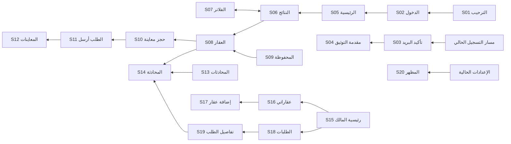

# سكون — مرجع UI للتنفيذ

حالة المرجع: **بروبوزال للمراجعة، وليس تنفيذًا في Flutter**. مصدر الهوية هو الـlanding في `frontend/landing`، ومصدر الوظائف هو `mobile/apps/sokoun_app`. البيانات والصور والحالات المعروضة توضيحية.

## المرجع البصري

- [معرض الـ٢٠ شاشة](index.html)
- [Design Map التفاعلي](design-map.html)
- [أساسيات Light](exports/design-map-light.png) / [أساسيات Dark](exports/design-map-dark.png)
- [كل الشاشات Light](exports/light-overview.png) / [كل الشاشات Dark](exports/dark-overview.png)

الورق الدافئ والأخضر العميق والتوقيع من الصفحة، مع ترتيب عملي للمعلومة والإجراء. الصورة تقود تفاصيل العقار، والطلبات تقود لوحة المالك، والحقول تقود شاشات الدخول والإضافة. القوس يظهر في الترحيب، والتوقيع خافت في الهيدر ولا يغطي المعلومات.

## الألوان الدلالية

[design-tokens.json](design-tokens.json) هو الجدول الكامل القابل للقراءة آليًا. استخدم وظيفة اللون، لا قيمة ثابتة عامة.

| الدور | Light | Dark |
| --- | --- | --- |
| canvas | `#F6F2E9` | `#0A120D` |
| surface | `#FCFBF7` | `#0E1912` |
| raised | `#ECE5D5` | `#16241B` |
| text | `#0C2A18` | `#ECF2EA` |
| muted | `#4B5650` | `#A1B0A6` |
| line | `#E3DCCB` | `#294632` |
| accent | `#0A5C18` | `#7FE08D` |
| chip | `#E1F0E2` | `#173A24` |
| action | `#0C2A18` | `#7FE08D` |
| on-action | `#FCFBF7` | `#0C2A18` |

الهيدر يحتفظ بـpine ونص ورقي في الوضعين. الصور وأزرار التحكم فوقها لا تتعكس ولا تُغمّق بفلاتر. حدود الداكن أقوى قليلًا من الـlanding لتمييز الحقول على الموبايل. المالك والمستأجر يشتركان في لون الإجراء. الانتظار يستخدم amber، والخطأ/الرفض rose، والحالة دائمًا مكتوبة بجوار اللون. التفاصيل الدلالية لباقي الحالات في JSON.

## الخطوط والمقاسات

- **Readex Pro:** العناوين البارزة، وزن 600–700.
- **IBM Plex Sans Arabic:** المحتوى والحقول والأزرار، وزن 400–700. الأصول الملتزمة تتضمن Medium وBold؛ تُستكمل أوزان الإنتاج عند الحاجة.
- العناوين عادة 24–28، والنص 14–16، والتفاصيل 12–13. المعاينة تتضمن metadata أصغر؛ عند التنفيذ تُراجع مع تكبير النص، ولا تُنسخ المقاسات الصغيرة آليًا.
- ارتفاع السطر 1.5–1.75؛ العنوان الموجز 1.4–1.5. محاذاة RTL، وعزل اتجاه البريد والأرقام وOTP عند الحاجة.
- مسافات 4 / 8 / 12 / 16 / 24 / 32؛ هوامش 20–24. radius التحكم 12، البطاقة 14، الشرائح 999.
- أهداف لمس 48dp، وأيقونات خطية 20–24. SafeArea والكيبورد والرجوع تتبع المنصة. إطار الهاتف في الصور للعرض فقط.

## Light / Dark / System

1. الافتراضي System، كما في `SokounThemeConfig.defaultMode` الحالي.
2. استخدم `ThemeCubit` و`ThemePreferences` الحاليين. مفتاح التطبيق `sokoun_theme_mode_v1`؛ مفتاح المتصفح `sukoon-proposal-theme` خاص بالمعاينة.
3. Light وDark ثابتان رغم تغير الجهاز؛ System يستجيب لتغير الجهاز أثناء التشغيل والاستئناف.
4. الانتقال 320ms مع `easeInOutCubic`، ويُلغى عند reduced motion عبر `SokounMotion`.
5. لا تصفّر المسار أو الحقول أو scroll أو الاختيارات عند التبديل.
6. status/navigation bars وbottom sheets وdialogs والكيبورد والخريطة تتبع المظهر. حالة فشل الصورة تتبع surface.
7. اعتمد `Theme.of(context).colorScheme` و`context.appColor(...)` أو امتداد سكون الحالي. لا تغيّر raw defaults في core لكل التطبيقات.

## تغطية الـ٢٠ شاشة

المسارات الكاملة والمكونات والحالات في [screen-manifest.json](screen-manifest.json). كل ID له PNG فاتح وداكن في `exports/`.

| ID | الشاشة | ملف المصدر |
| --- | --- | --- |
| S01 | الترحيب | `welcome_screen.dart` |
| S02 | تسجيل الدخول | `login_screen.dart` |
| S03 | تأكيد البريد | `otp_screen.dart` |
| S04 | توثيق الهوية | `kyc_intro_screen.dart` |
| S05 | الرئيسية للمستأجر | `tenant_home_screen.dart` |
| S06 | نتائج البحث | `tenant_search_results_screen.dart` |
| S07 | فلترة العقارات | `tenant_filter_screen.dart` |
| S08 | تفاصيل العقار | `property_details_screen.dart` |
| S09 | المحفوظة | `favorites_screen.dart` |
| S10 | حجز معاينة | `book_visit_screen.dart` |
| S11 | تم إرسال الطلب | `visit_confirmed_screen.dart` |
| S12 | معايناتي | `tenant_visits_screen.dart` |
| S13 | المحادثات | `chats_screen.dart` |
| S14 | محادثة المالك | `chat_screen.dart` |
| S15 | الرئيسية للمالك | `owner_home_screen.dart` |
| S16 | عقاراتي | `owner_properties_screen.dart` |
| S17 | إضافة عقار | `owner_property_flow_screen.dart` |
| S18 | طلبات المعاينة | `owner_visit_requests_screen.dart` |
| S19 | تفاصيل طلب المعاينة | `owner_request_details_screen.dart` |
| S20 | المظهر | `appearance_screen.dart` |

S17 تعرض خطوة البيانات الأساسية؛ الصور والتسعير والمراجعة تحتفظ بترتيب التطبيق. S04 مقدمة التوثيق، وبعدها الرفع والمراجعة. S20 تحت الإعدادات في التطبيق؛ اختصار الحساب داخل البروبوزال لتسهيل المراجعة فقط.

## علاقات التنقل

قواعد `WorkspaceNavigation` والمصادقة الحالية هي مصدر السماح بالدخول. تسجيل الدخول لا يفرض OTP جديدًا؛ OTP يظهر حيث يفرضه التدفق الحالي.

## الحالات المطلوبة

| الأسرة | حالات التنفيذ |
| --- | --- |
| الدخول / OTP | فارغ، خطأ تحقق، إرسال جارٍ، فشل الخادم، رمز غير صالح/منتهي، مؤقت إعادة إرسال |
| البحث والعقارات | skeleton، بيانات مخزنة، تحديث، خطأ مع retry، لا نتائج، غير موثّق، حفظ/إلغاء |
| المعاينات | لا مواعيد، وقت أصبح غير متاح، مراجعة، إرسال، انتظار المالك، مؤكدة، ملغاة، مكتملة |
| طلبات المالك | انتظار، قبول/رفض مع تأكيد، تحديث يمنع التكرار، فشل يحتفظ بالحالة السابقة، تحذير توثيق |
| المحادثات | تحميل، فارغة، غير مقروء، إرسال، فشل/retry، انقطاع، محادثة مقيّدة |
| إضافة عقار | مسودة واستعادتها، validation، حفظ جارٍ/فاشل، صور، تسعير، مراجعة، خروج مع تغييرات |
| المظهر | System/Light/Dark، حفظ الاختيار، تغير الجهاز، reduced motion |

الـDesign Map يعرض عينات loading/empty/error/status. المعرض يحتوي ٢٠ سطحًا أساسيًا × وضعين، وليس صورة منفصلة لكل فرع من الحالات. المصفوفة قائمة تنفيذ كل سطح.

## قواعد المنتج التي يجب الحفاظ عليها

- الشارات وحالات الهوية والملكية من بيانات الـAPI؛ «موثّق» ليس default.
- إرسال طلب المعاينة يعني **بانتظار المالك**، وليس تأكيد الموعد.
- `BookVisitScreen` يعيد فحص الوقت على الخادم قبل الإرسال؛ الاحتفاظ بالفحص ضروري.
- قبول/رفض الطلب يتأكد قبل الإرسال، ولا ينجح بصريًا إلا بعد استجابة الخادم.
- المالك الذي يشاهد عقاره يرى إدارة العقار وفق الكود الحالي.
- المعلومات والمرافق والتقييمات والخريطة وشروط الإيجار لا تُحذف لأن اللقطة تعرض أعلى الشاشة فقط.
- كل النصوص تمر عبر `LocaleKeys` و`lang.json`؛ لا تتغير الـAPIs أو الصلاحيات بسبب التصميم.

## ترتيب التنفيذ

1. توكنز وخطوط سكون داخل `sokoun_theme.dart` وامتداد الألوان، مع theme preferences الحالية.
2. تحديث primitives: النصوص، الأزرار، الحقول، الشرائح، البطاقات، `SokounActionFooter`، التنقل، حالات الفشل والفراغ. الحفاظ على defaults التطبيقات الأخرى.
3. S05/S08/S18 أولًا لتثبيت عائلات التصفح والقرار والإدارة، ثم توسيع مجموعات الشاشات.
4. الالتزام بفصل screen orchestration عن widgets وCubits وبـAGENTS.md عند تنفيذ Flutter.
5. مراجعة Arabic/English، تكبير النص، phone/tablet، SafeArea والكيبورد، تغيير الجهاز، الاستمرارية، reduced motion وحالات الـAPI، ثم checks التطبيق المطلوبة.

## مصدر الأصول

التوقيع: `frontend/landing/src/assets/brand/signature.ts`. الصور: `frontend/landing/public/images/listings/`. IBM Plex: `frontend/landing/src/assets/fonts/`. Readex subsets مأخوذة من build الصفحة الحالية ومحفوظة في `assets/` لضمان الاستقلال عن `.next`. عينة Tajawal من `mobile/packages/core/assets/fonts/Tajawal/`.

الـHTML مستقل عن CDN، والـPNG مرجع بصري، وJSON/Markdown مرجع الأدوار والحالات والربط بالكود. CSS المعاينة لا يحل محل Flutter tokens.
